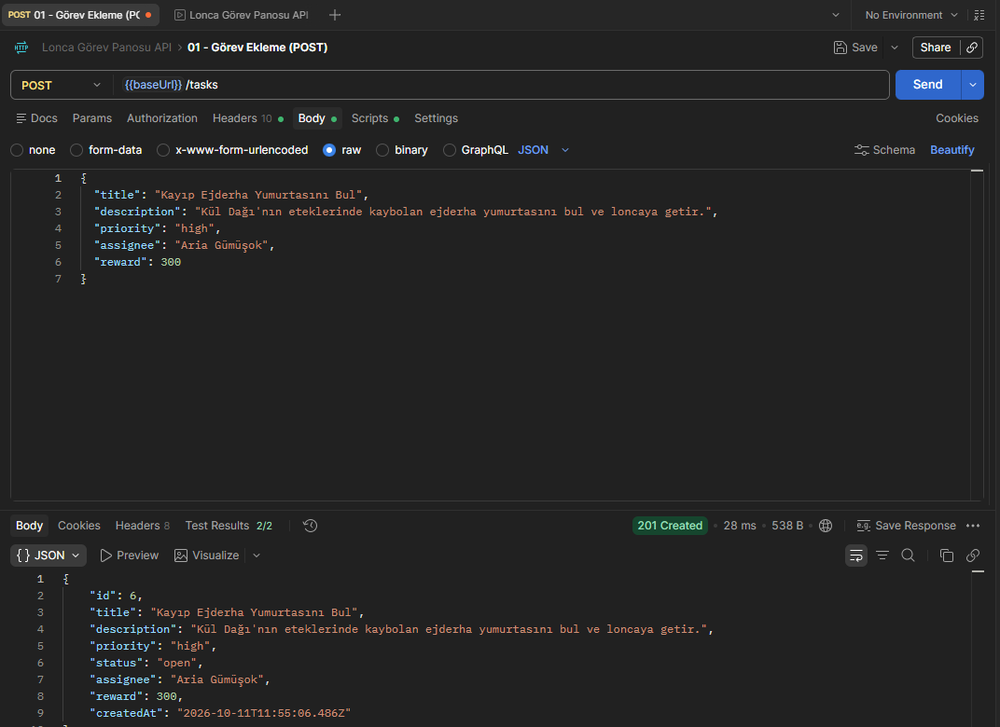
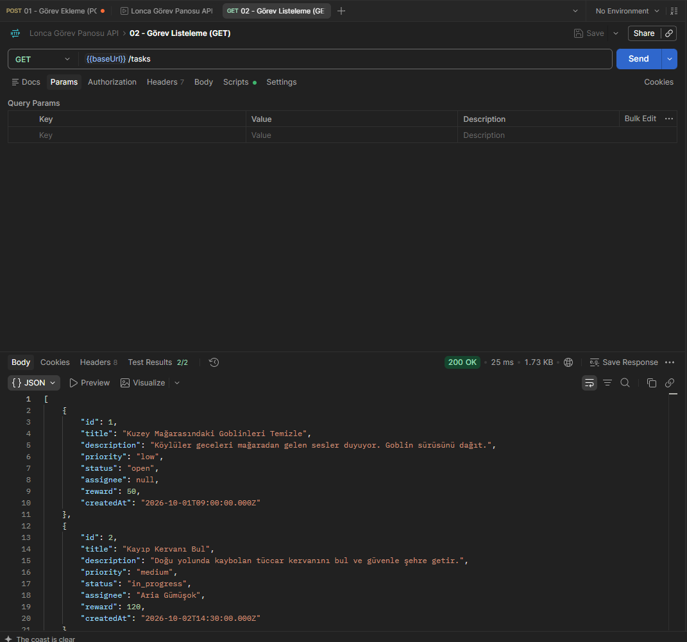
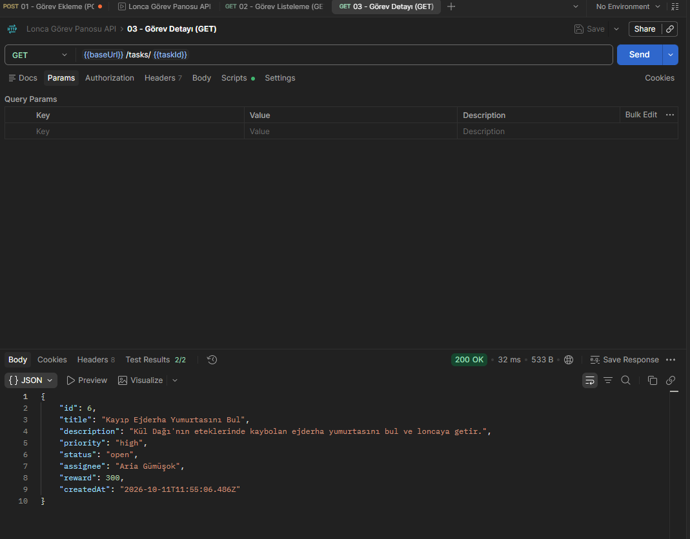
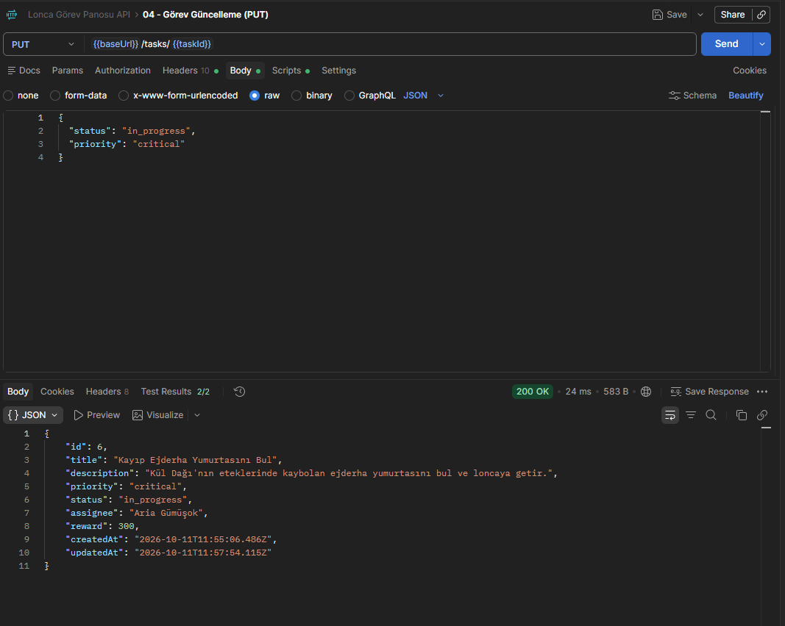
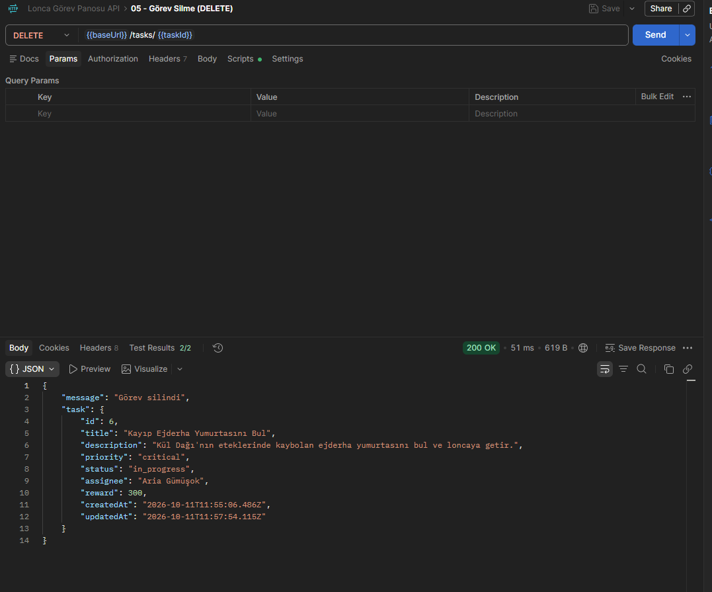
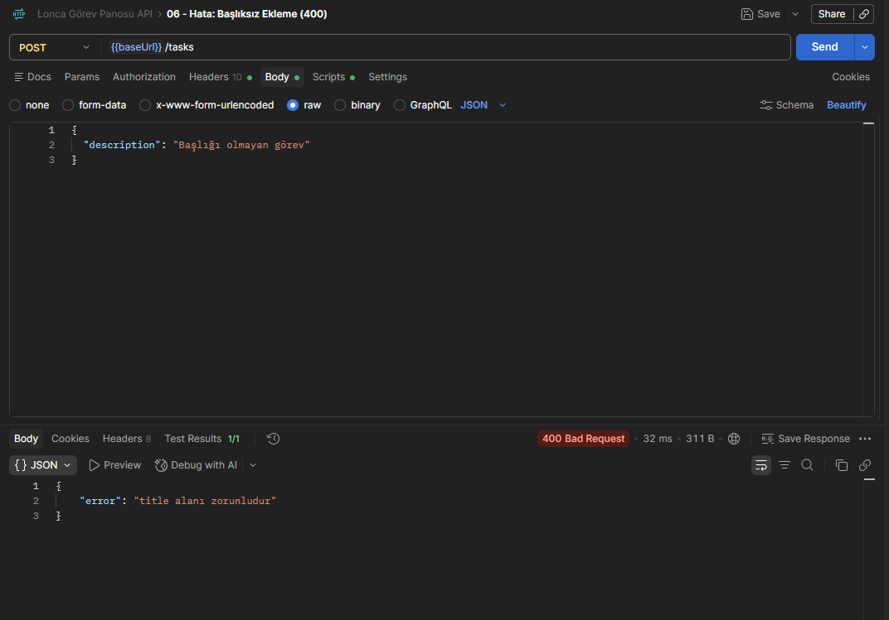
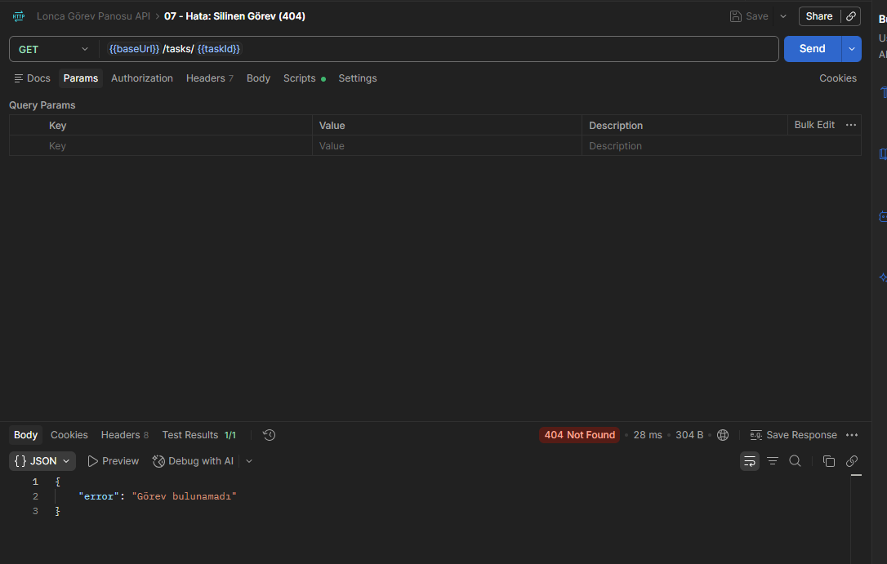
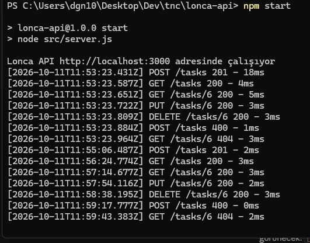

# 🗡️ Lonca Görev Panosu API

Fantastik bir maceracılar loncasının görevlerini yöneten REST API.
Görevler oluşturulur, maceracılara atanır, önceliğe göre sınıflanır ve durumları takip edilir.

**Teknolojiler:** Node.js, Express.js, JSON dosya tabanlı veri

| Doküman | İçerik |
|---|---|
| 📄 [Proje Tanıtım Dokümanı](docs/PROJE_TANITIM.md) | Amaç, senaryo, mimari |
| 📘 [API Dokümantasyonu](docs/API.md) | Tüm uç noktalar, istek/yanıt örnekleri, doğrulama kuralları, hata kodları |
| 🧪 [Test Dokümantasyonu](docs/TEST.md) | Otomatik testler ve Postman test senaryoları |
| 🧭 [Kullanım Kılavuzu](docs/KULLANIM_KILAVUZU.md) | Adım adım kurulum, sık yapılan işlemler, sorun giderme |

## Kurulum

```bash
git clone https://github.com/dckaratas/lonca-api.git
cd lonca-api
npm install
npm start          # veya geliştirme için: npm run dev
npm test           # otomatik testler
```

Sunucu varsayılan olarak `http://localhost:3000` adresinde çalışır.

| Ortam değişkeni | Varsayılan | Açıklama |
|---|---|---|
| `PORT` | `3000` | Sunucu portu |
| `CORS_ORIGIN` | `*` | API'ye erişebilecek web adresi. API internete açılacaksa web panelinin adresiyle kısıtlanmalıdır (ör. `https://lonca.netlify.app`). |

> **Not:** API'de kimlik doğrulama yoktur; eğitim projesi olarak yerel kullanım içindir.

## Klasör Yapısı

```
src/
├── server.js                       # Sunucuyu başlatır
├── app.js                          # Express uygulaması, middleware'ler, hata yakalayıcı
├── constants.js                    # Öncelik ve durum değerleri
├── routes/
│   ├── taskRoutes.js               # /tasks routing
│   └── reportRoutes.js             # /reports routing
├── controllers/
│   ├── taskController.js           # CRUD, filtreleme, arama, sayfalama
│   └── reportController.js         # Raporlar
├── middleware/
│   ├── logger.js                   # İstek loglama middleware'i
│   └── validateTask.js             # Doğrulama middleware'leri
└── data/
    ├── tasks.json                  # Veri dosyası
    └── store.js                    # JSON okuma/yazma
test/api.test.js                    # Otomatik testler (node:test)
logs/requests.log                   # Logger çıktısı (otomatik oluşur)
```

## Veri Modeli — Görev (Task)

| Alan | Tip | Açıklama |
|---|---|---|
| id | number | Otomatik artan |
| title | string | **Zorunlu** — görev başlığı |
| description | string | Görev açıklaması |
| priority | `critical` \| `high` \| `medium` \| `low` | Öncelik (varsayılan `medium`). Arayüzde lonca rütbesi olarak gösterilir: S / A / B / C |
| status | `open` \| `in_progress` \| `completed` | Görev durumu |
| assignee | string \| null | Görevi üstlenen maceracı |
| reward | number | Altın ödülü |
| createdAt / updatedAt | ISO tarih | Zaman damgaları |

## Endpoint'ler

| Method | Endpoint | Açıklama |
|---|---|---|
| GET | `/tasks` | Tüm görevleri listele |
| GET | `/tasks/:id` | Görev detayı |
| POST | `/tasks` | Yeni görev ekle |
| PUT | `/tasks/:id` | Görevi güncelle |
| DELETE | `/tasks/:id` | Görevi sil |
| GET | `/tasks/search?keyword=` | Başlık ve açıklamada arama |
| GET | `/tasks/assignee/:name` | Bir maceracının görevleri |
| GET | `/reports/completed` | Tamamlanan görevler raporu |
| GET | `/reports/pending` | Bekleyen görevler raporu |
| GET | `/reports/summary` | Genel özet raporu |

### Filtreleme, sıralama ve sayfalama

`GET /tasks` (ve arama/atanan kişi uç noktaları) şu sorgu parametrelerini kabul eder:

| Parametre | Örnek | Açıklama |
|---|---|---|
| `status` | `?status=completed` | Duruma göre filtre |
| `priority` | `?priority=high` | Önceliğe göre filtre |
| `sort`, `order` | `?sort=createdAt`, `?sort=reward&order=desc` | Sıralama (`createdAt`, `reward`, `priority`, `title`) |
| `page`, `limit` | `?page=1&limit=10` | Sayfalama; yanıt `{ data, pagination }` biçiminde döner |

Ayrıntılar ve yanıt örnekleri: [API Dokümantasyonu](docs/API.md).

### Örnek istek — Görev ekleme

```http
POST /tasks
Content-Type: application/json

{
  "title": "Kuzey Mağarasındaki Goblinleri Temizle",
  "description": "Goblin sürüsünü dağıt.",
  "priority": "low",
  "assignee": "Aria Gümüşok",
  "reward": 50
}
```

## Doğrulama Middleware'i

`src/middleware/validateTask.js` gelen veriyi controller'dan önce kontrol eder ve hatalı istekte **400** döner.
`title` zorunlu ve en fazla 100 karakter; `description` metin; `priority` ve `status` yalnızca tanımlı değerler;
`assignee` boş olmayan metin veya `null`; `reward` 0 veya daha büyük sayı olmalıdır. Sorgu parametreleri ve `:id` de doğrulanır.
Birden fazla hata varsa hepsi `details` dizisinde listelenir:

```json
{
  "error": "title alanı zorunludur",
  "details": ["title alanı zorunludur", "priority şunlardan biri olmalıdır: critical, high, medium, low"]
}
```

## Logger Middleware

Her istek için method, endpoint, zaman damgası, durum kodu ve süre hem konsola hem `logs/requests.log` dosyasına yazılır:

```
[2026-10-10T12:04:29.948Z] PUT /tasks/6 200 - 1ms
```

## Testler

### Otomatik testler

```bash
npm test
```

11 test; CRUD akışını, doğrulama kurallarını, filtreleme/arama/sayfalamayı ve raporları kontrol eder.
Testler verinin geçici bir kopyasında çalışır, `tasks.json` değişmez. Ayrıntılar: [Test Dokümantasyonu](docs/TEST.md).

### Postman

Tüm istekler [`docs/lonca-api.postman_collection.json`](docs/lonca-api.postman_collection.json) koleksiyonundadır
(Postman → **Import**). İstekler sırayla çalıştırılmalıdır: ekleme isteği oluşan görevin id'sini `{{taskId}}`
değişkenine kaydeder, sonraki istekler bu görevi kullanır. Her isteğin durum kodunu doğrulayan testleri vardır.

| # | İstek | Beklenen | Ekran görüntüsü |
|---|---|---|---|
| 1 | `POST /tasks` — Görev ekleme | 201 Created |  |
| 2 | `GET /tasks` — Görev listeleme | 200 OK |  |
| 3 | `GET /tasks/:id` — Görev detayı | 200 OK |  |
| 4 | `PUT /tasks/:id` — Görev güncelleme | 200 OK |  |
| 5 | `DELETE /tasks/:id` — Görev silme | 200 OK |  |
| 6 | `POST /tasks` — Başlıksız ekleme | 400 Bad Request |  |
| 7 | `GET /tasks/:id` — Silinmiş görev | 404 Not Found |  |

Logger middleware'in bu isteklerdeki konsol çıktısı:



Filtreleme, arama, raporlama ve doğrulama istekleri:

| # | İstek | Beklenen | Ekran görüntüsü |
|---|---|---|---|
| 9 | `GET /tasks?status=completed` | 200 OK | `09_filtre_durum_GET.png` |
| 10 | `GET /tasks?priority=high` | 200 OK | `10_filtre_oncelik_GET.png` |
| 11 | `GET /tasks/search?keyword=ejderha` | 200 OK | `11_arama_GET.png` |
| 12 | `GET /tasks/assignee/Aria Gümüşok` | 200 OK | `12_atanan_kisi_GET.png` |
| 13 | `GET /tasks?sort=reward&order=desc&page=1&limit=2` | 200 OK | `13_siralama_sayfalama_GET.png` |
| 14 | `GET /reports/completed` | 200 OK | `14_rapor_tamamlanan_GET.png` |
| 15 | `GET /reports/pending` | 200 OK | `15_rapor_bekleyen_GET.png` |
| 16 | `GET /reports/summary` | 200 OK | `16_rapor_ozet_GET.png` |
| 17 | `POST /tasks` — Geçersiz öncelik ve ödül | 400 Bad Request | `17_hata_400_dogrulama.png` |
| 18 | `GET /tasks?status=done` — Geçersiz filtre | 400 Bad Request | `18_hata_400_gecersiz_filtre.png` |
